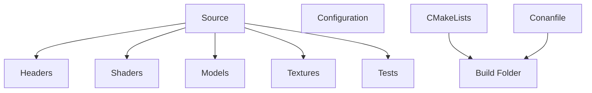

# AGENTS

This file contains short, actionable instructions for AI coding agents working on the NEE project.

## Build
```
# Resolve dependencies with Conan (build missing binaries)
conan install . --output-folder=build --build=missing

# Configure and build with CMake (Release configuration by default)
cmake -S . -B build/build -DCMAKE_BUILD_TYPE=Release
cmake --build build/build --config Release
```

The executable will be at `build/build/Release/NEE.exe`.

## Test
The project uses **GoogleTest** for unit testing.

```bash
# Run all tests via CTest
ctest --test-dir build/build --output-on-failure
```

## Common Pitfalls
- **Missing Conan profile**: Ensure a default profile exists (`~/.conan2/profiles/default`).
- **CMake cache**: Delete `build/` folder if you encounter stale configuration.

## Useful Tools
### Run and Build
- **Quick build**: Use the *Build_CMakeTools* target to compile the current configuration.
- **Run executable**: After a successful build, execute `C:\Users\lemio.BEHEMOTH\Projects\NEE\build\build\Release\NEE.exe`.

### Linting & Static Analysis
- The project uses *clang‑tidy*; run:
```bash
clang-tidy -p=build/build src/*.cpp
```
+- Configure `-Werror` to treat warnings as errors during CI.

## Best Practices for Modern C++
This section summarizes key conventions used throughout the codebase:

| Topic                  | Guideline                                                                                                 |
| ---------------------- | --------------------------------------------------------------------------------------------------------- |
| **Language Standard**  | Use **C++23** (`-std=c++23`) with `CMAKE_CXX_STANDARD=23` and `CMAKE_CXX_EXTENSIONS OFF`.                 |
| **Memory Safety**      | Prefer smart pointers (`std::unique_ptr`, `std::shared_ptr`) and containers over raw pointers.            |
| **Move Semantics**     | Implement move constructors/assignment where appropriate; use `std::move` to avoid copies.                |
| **Exception Handling** | Reserve exceptions for truly exceptional cases; return `std::optional` or error codes otherwise.          |
| **Testing**            | The project uses GoogleTest for unit testing; tests reside in the `tests/` directory.                     |
| **Build System**       | Use CMake targets: `add_executable`, `target_link_libraries`, and interface libraries for common headers. |
| **Static Analysis**    | Run clang‑tidy and cppcheck as part of CI; include `.clang-tidy`.                                         |

These guidelines aid agents in understanding the project’s coding style and help maintain consistency.

## Project Map
The following Mermaid diagram provides a high‑level view of the main components, useful for quick navigation by LLMs.


