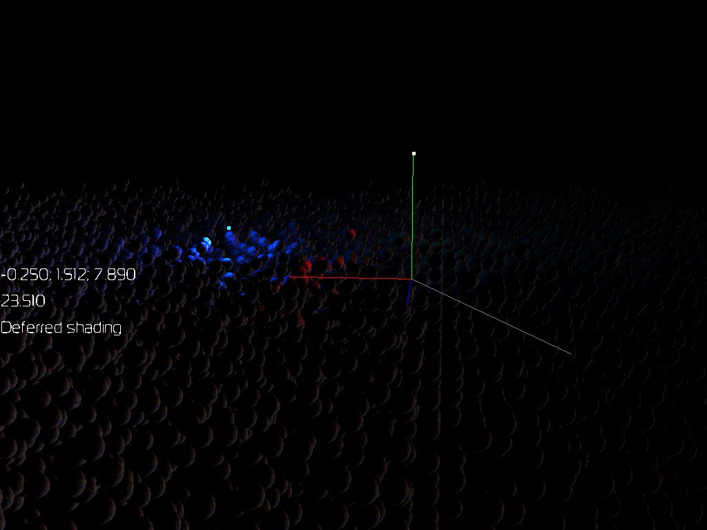

New Exprience Engine

[](https://github.com/Lemiort/NEE/actions/workflows/build.yaml)

# README #
This is realization of Openg3.3+ graphics engine. Adapted to conan2

## Coordinates and units

The world is right handed: +X is right, +Y is up, and the default camera looks
along -Z. Positive rotations follow the right hand rule. Front faces use
counterclockwise winding, and OpenGL clip depth is -1 to +1. Camera FOV,
object Euler angles, and spotlight cutoff are specified in degrees at the engine
API; GLM calculations use radians internally. Treat one world unit as one meter
when authoring scene values. Imported model coordinates are used as stored.

## Runtime diagnostics

The application writes logs to `NEE.log` beside the executable and to standard
error. 




# Building

Use following command to configure cmake before building

```bash
conan install . --output-folder=build --build=missing -s compiler.cppstd=23
or
conan install . --output-folder=build --build=missing --build=glad/* --build=glfw/* --build=bzip2/* --build=kuba-zip/* --build=spdlog/* --build=fmt/* -pr:a mingw-debug
```
