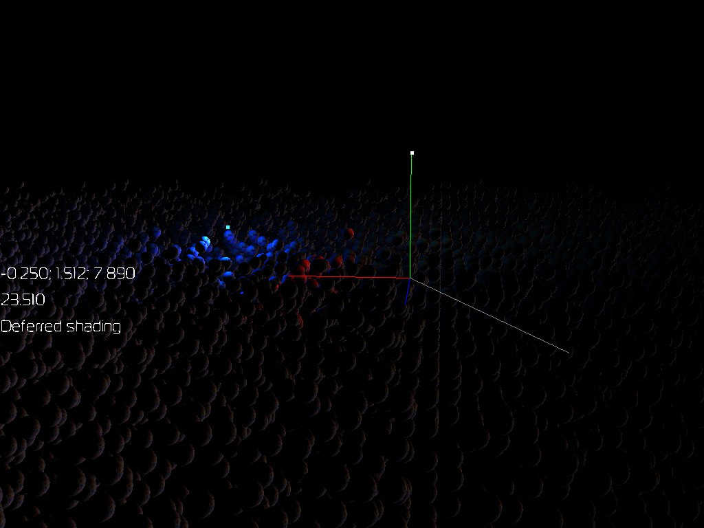

# NEE: New Experience Engine

[](https://github.com/Lemiort/NEE/actions/workflows/build.yaml)

## Overview

NEE is a C++23 graphics engine using OpenGL 4.6 core and Conan 2.
Running it requires a desktop driver supporting OpenGL 4.6 and GLSL 4.60.
The system OpenGL implementation on macOS does not meet this requirement.

## Project layout

The engine builds as the static library target `nee` (alias `nee::nee`) from
`src/` and `include/`. Its public include directory, compile definitions, and
header-level dependencies (GLAD, GLM, gsl-lite) propagate to anything linking
it. The demo executable `NEE` lives in `app/`, and the unit tests in `tests/`
link the same library instead of compiling engine sources themselves.

## OpenGL resource setup

The renderer uses [Direct State Access](https://wikis.khronos.org/opengl/Direct_State_Access)
to configure named textures, buffers, framebuffers, vertex arrays, and transform
feedback objects without temporary bindings. Static mesh data is uploaded
directly from interleaved model vertices into immutable buffer storage. Mesh
vertex layouts are cached and reused for individual and instanced draws;
text, debug lines, billboards, skyboxes, and fullscreen passes own their VAOs.

Textures use sized immutable storage with explicit mip levels. Resizing render
targets creates replacement storage. Material textures bind in batches with
`glBindTextures`, and material uniforms use `glProgramUniform*` to address their
program directly. Text and instance streams retain resizable storage through
`glNamedBufferData`.

Texture uploads, texture queries, and framebuffer setup leave existing bindings unchanged.
Rendering still binds its VAO, program, render target, and texture units.
Texture `Bind` methods accept `GL_TEXTURE0 + unit` as before; they now select
the unit directly without changing the active texture selector.

## Coordinates and units

The world is right handed: +X is right, +Y is up, and the default camera looks
along -Z. Positive rotations follow the right hand rule. Front faces use
counterclockwise winding, and OpenGL clip depth is -1 to +1. Camera FOV,
object Euler angles, and spotlight cutoff are specified in degrees at the engine
API; GLM calculations use radians internally. Treat one world unit as one meter
when authoring scene values. Imported model coordinates are used as stored.

## Simulation thread

Simulation runs on its own thread at a fixed rate, so its results do not
depend on frame rate and a slow simulation step never stalls rendering.

- `FixedStepClock` turns elapsed real time into a whole number of fixed steps.
  It supports pausing, single-stepping and a time scale, caps the steps run at
  once, and clamps long gaps such as a debugger break. It reads no time source
  itself, so it is unit-tested on the CPU.
- `SimulationThread` runs a step function on a worker thread, paced by the
  clock. The step function receives only the step index and duration. Pause,
  single-step and time-scale commands are thread-safe, and an exception thrown
  by a step stops the worker and is kept for the owner to report.
- `SnapshotBuffer<T>` passes immutable snapshots from the simulation to the
  renderer. Publish one after each step; each frame, sample it one step behind
  `SimulationThread::GetTiming().estimatedSeconds` and interpolate between the
  two snapshots it returns.

The demo animates its spheres on a 20 Hz simulation thread and interpolates
the rendered rotation. P pauses or resumes the simulation and N advances it one
step while paused.

## Debug UI with Dear ImGui

`ImGuiOverlay` draws [Dear ImGui](https://github.com/ocornut/imgui) on top of
the engine's frames with ImGui's GLFW and OpenGL 3 backends. Create it after
your own GLFW callbacks (ImGui forwards events to them), call `BeginFrame()`
each frame before any ImGui calls and `Render()` after the scene. While
`WantsMouse()` or `WantsKeyboard()` is true, the cursor or keyboard belongs to
the UI and the application should ignore that input.

Between the two, use ImGui's own API directly (`ImGui::Begin`,
`ImGui::BeginTable`, ...). `imgui.h` is available to anything that links
`nee`.

The demo shows a debug window with FPS, the render mode, and pause, step and
time-scale controls for its animation.

## Runtime diagnostics

The application writes logs to `NEE.log` beside the executable and to standard
error.

`SaveScreenshot` (`include/Screenshot.hpp`) writes the current framebuffer to
a PNG or JPEG file; the demo saves one to `screenshots/` when you press F12.



## Building

Resolve dependencies and build Release:

```bash
conan install . --output-folder=build --build=missing -s build_type=Release -s compiler.cppstd=23
cmake --preset conan-release -DBUILD_TESTING=ON
cmake --build --preset conan-release
ctest --test-dir build/build/Release -C Release --output-on-failure
```

`conanfile.txt` explicitly generates GLAD for OpenGL 4.6 core. Re-run Conan
when updating an existing checkout so the loader matches the renderer. Use
`-pr:a mingw` with Conan when building with a configured LLVM-MinGW profile.
Run the executable from the CMake binary directory so it can find the copied
`shaders`, `textures`, `models`, `fonts`, and `config` directories.
