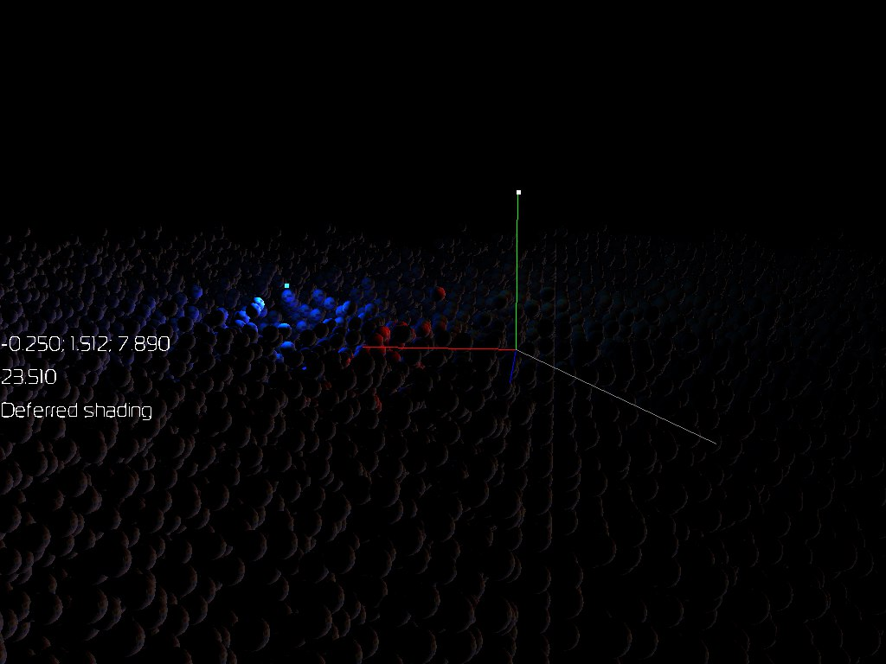

New Exprience Engine

[](https://github.com/Lemiort/NEE/actions/workflows/build.yaml)

# README #
This is realization of Openg3.3+ graphics engine. Adapted to conan2

## Coordinates and units

The world is right handed: +X is right, +Y is up, and the default camera looks
along -Z. Positive rotations follow the right hand rule. Front faces use
counterclockwise winding, and OpenGL clip depth is -1 to +1. Camera FOV,
object Euler angles, and spotlight cutoff are specified in degrees at the engine
API; GLM calculations use radians internally. Treat one world unit as one meter
when authoring scene values. Imported model coordinates are used as stored.

## Vulkan backend bootstrap

`VulkanBackend` is a separate RAII class and CMake library (`nee_vulkan`). It
creates a Vulkan 1.0 instance, GLFW window surface, physical/logical device, and
graphics/presentation queues, with `VK_KHR_swapchain` enabled for future rendering.
`Initialize` returns a `VkResult` and releases partial resources on failure;
`Shutdown` is safe to call repeatedly. Destroy it before its GLFW window and
before calling `glfwTerminate`. Create the window with `GLFW_CLIENT_API` set to
`GLFW_NO_API`. The existing `NEE` executable still uses OpenGL.

Conan supplies `volk/1.4.357.0` and its matching Vulkan headers. Volk dynamically
loads the system Vulkan runtime, so compiling does not require a Vulkan SDK.
Running requires a Vulkan-capable GPU driver and a display. No validation layers
are required or enabled. This bootstrap currently targets Windows and Linux;
macOS/MoltenVK portability support is not set up.

For a fresh Release build with Ninja (append `-pr:a mingw-debug` to Conan when
using the local LLVM-MinGW profile), run from the compiler environment matching
your Conan profile. If the profile defines compiler paths in `[buildenv]`, activate
the generated `build/vulkan/build/Release/generators/conanbuild.bat` in a Windows
Command Prompt, or source `conanbuild.sh` on Linux, after installing dependencies:

```bash
conan install . --output-folder=build/vulkan --build=missing -s:a build_type=Release -s:a compiler.cppstd=23 -c tools.cmake.cmaketoolchain:generator=Ninja
cmake -S . -B build/vulkan/project -G Ninja -DCMAKE_BUILD_TYPE=Release "-DCMAKE_TOOLCHAIN_FILE=../build/Release/generators/conan_toolchain.cmake"
cmake --build build/vulkan/project --config Release
ctest --test-dir build/vulkan/project -C Release --output-on-failure
```

With Ninja, run `build/vulkan/project/NEEVulkanSmoke.exe` on Windows (without
`.exe` on Linux); Visual Studio puts it under `Release/`. It opens a hidden window,
initializes/reinitializes Vulkan, checks cleanup, and exits. To register this GPU
test with CTest, configure with `-DNEE_ENABLE_VULKAN_SMOKE_TEST=ON`.
There is no swapchain, command recording, or drawing yet; those are the next steps
before connecting the backend to the scene renderer.

## Runtime diagnostics

The application writes logs to `NEE.log` beside the executable and to standard
error. 




# Building

Use following command to configure cmake before building

```bash
conan install . --output-folder=build --build=missing -s compiler.cppstd=23
or
conan install . --output-folder=build --build=missing --build=glad/* --build=glfw/* --build=bzip2/* --build=kuba-zip/* --build=spdlog/* --build=fmt/* -pr:a mingw-debug
```
